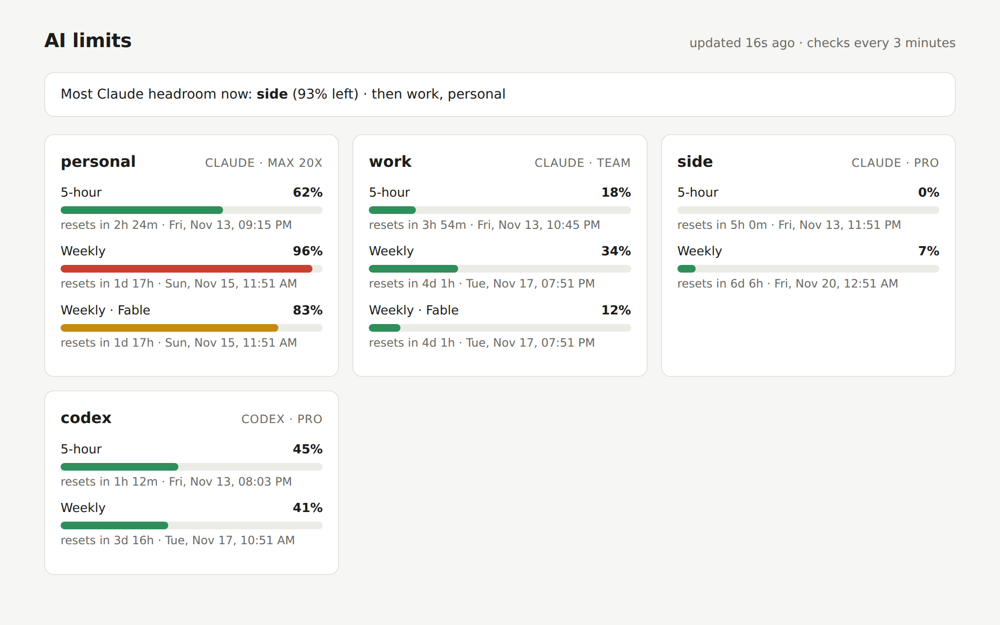

# Headroom

A local dashboard that shows how much of your Claude Code and Codex usage limits you have left on each account, and a launcher that moves a Claude Code chat to your next account when the current one runs out.



The screenshot uses sample data.

## What you get

**The dashboard.** `http://127.0.0.1:8787` shows one card per account with its 5-hour, weekly and per-model limits and when each one resets.

**`claude-auto <profile>`.** It starts Claude Code on that account. When the account reaches 95% of a limit that applies to the model you are using, or a reply fails on a rate limit, it closes Claude after the reply and reopens the same chat on the next account that still has room. If the account you asked for is already full, it starts on the next one.

I built it because I got tired of checking each account by hand and restarting chats when one ran dry.

## How it works

`server.py` reads the login token each profile already has on disk (`.credentials.json` for Claude Code, `auth.json` for Codex) and asks the provider's usage endpoint. It asks each account at most once every 3 minutes. If the provider answers HTTP 429 it waits 10 minutes for that account and shows the last good reading. It never refreshes a token. Refresh tokens are single-use, so refreshing one here could log a running session out.

`autoswitch.py` runs as a Claude Code `Stop` and `StopFailure` hook. It asks the dashboard for the current numbers. If the account is at the threshold, it writes a small marker file and ends the Claude process. `claude-auto` sees the marker and runs `claude --resume <session> --model <model>` on the next account.

A few rules keep it from doing damage:

- It never closes Claude while a background command or a subagent is running. It waits until that work finishes and the chat is idle, then switches, without needing another reply (a subagent that dies on the same limit leaves nothing to reply to).
- If the dashboard is down or has no reading for the account, nothing switches.
- A spare account nobody has opened for about 8 hours has an expired login token, so the dashboard can't read it. When choosing where to switch, `autoswitch.py` uses that account's last good reading instead, counting any limit whose reset time has passed as 0. Starting Claude on it renews the token. If the old reading was wrong and the account is full, the rate-limit failure moves the chat on to the next account.
- After a normal reply, the reopened chat waits for you. After a reply the limit cut off, it sends a message asking Claude to continue.
- The hooks do nothing in a Claude session that was not started by `claude-auto`.

## Requirements

- Linux with systemd. On macOS, Claude Code keeps the login in the Keychain instead of `.credentials.json`, so the dashboard cannot read it as written.
- Python 3.8 or later. No packages to install.
- Claude Code, logged in once per account.

## Install

```bash
git clone https://github.com/UsmanBuk/Headroom && cd Headroom
./install.sh
```

The script copies the files to `~/.local/share/ai-limits`, links `claude-auto` into `~/.local/bin`, and starts the dashboard as a systemd user service. It creates `~/.config/ai-limits/config.json` from the example if you have none.

Then do three things.

### 1. List your accounts

Edit `~/.config/ai-limits/config.json`:

```json
{
  "port": 8787,
  "threshold": 95,
  "claude": [
    {"name": "personal", "dir": "~/.claude"},
    {"name": "work", "dir": "~/.claude-work"}
  ],
  "codex": [
    {"name": "codex", "dir": "~/.codex"}
  ],
  "claude_args": []
}
```

| Key | Meaning |
|---|---|
| `claude` | Claude Code profiles, in switch order. The first one under the threshold is used next. |
| `codex` | Codex homes to show on the dashboard. Leave it out if you don't use Codex. |
| `threshold` | Percentage at which a chat moves to the next account. Default 95. |
| `port` | Dashboard port. Default 8787. |
| `claude_args` | Arguments added to every `claude` launch, including the relaunch after a switch. |

Run `systemctl --user restart ai-limits` after changing it.

### 2. Give each account a profile that shares chat history

A profile is a Claude Code config directory with its own login. Create one and log in:

```bash
mkdir ~/.claude-work
ln -s ~/.claude/projects ~/.claude-work/projects
CLAUDE_CONFIG_DIR=~/.claude-work claude    # then /login
```

The `projects` link matters. Claude Code keeps chat transcripts there, and a chat can only be reopened on another account if both profiles see the same folder. You can link `settings.json`, `skills` and the rest the same way if you want the profiles to behave alike.

### 3. Add the hooks

Put this in the `settings.json` of every profile (once, if they share the file through a link). Use your own home directory in the path.

```json
{
  "hooks": {
    "Stop": [
      {"hooks": [{"type": "command", "command": "python3 /home/you/.local/share/ai-limits/autoswitch.py hook", "timeout": 30}]}
    ],
    "StopFailure": [
      {"matcher": "rate_limit", "hooks": [{"type": "command", "command": "python3 /home/you/.local/share/ai-limits/autoswitch.py hook", "timeout": 30}]}
    ]
  }
}
```

## Use

```bash
claude-auto personal
claude-auto work --model opus
```

A shell function per account saves typing:

```bash
work() { claude-auto work "$@"; }
```

## Things to know

- Both usage endpoints are undocumented. Either provider can change or remove them, and the dashboard will show an error card when that happens.
- Check your plan's terms before you spread work across several accounts. This tool does not decide that for you.
- Tokens stay on your machine. The server sends each one only to its own provider's API, and it listens on `127.0.0.1` only.
- A card that says the login token expired fixes itself the next time you open that profile, because Claude Code refreshes the token then.

## Uninstall

```bash
systemctl --user disable --now ai-limits
rm -rf ~/.local/share/ai-limits ~/.config/ai-limits ~/.config/systemd/user/ai-limits.service ~/.local/bin/claude-auto
```

Then remove the two hook entries from `settings.json`.

## License

MIT
